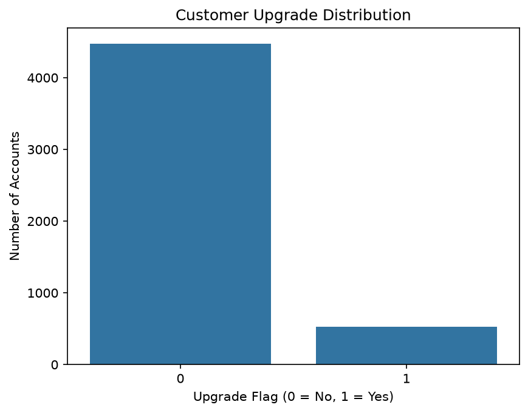

# SaaS Customer Upgrade & Expansion Prediction Using XGBoost

## 1. Project Overview

This project uses machine learning to predict whether a SaaS customer will upgrade or expand their subscription.
The goal is to explore customer account information, subscription details, feature usage, and support interactions to build a classification model that predicts customer upgrades.

## 2. Business Problem

SaaS companies want to understand which customers are likely to upgrade their subscriptions or expand their usage.

Identifying potential upgrade customers can help businesses understand customer behavior and explore opportunities for revenue growth.

**Objective:** Build a machine learning classification model to predict customer upgrades using account-level customer data.

## 3. Dataset

The project uses multiple related datasets containing customer and subscription information.
The datasets include:

- **Accounts:** Customer account information and signup dates.
- **subscription:** Customer subscription plan details.
- **Feature Usage:** Customer feature usage and activity.
- **Support Tickets:** Customer support interactions and ticket details.
- **Churn Events:** Information about customer churn events.

These datasets were combined to create a consolidated account-level dataset for machine learning.

## 4. Data Cleaning and Preparation

The following steps were performed:

- Loaded the datasets using pandas.
- Inspected the columns, data types, and dataset dimensions.
- Checked for missing values and duplicates.
- Handled missing values where appropriate.
- Reviewed data types and prepared the data for further analysis.
- Combined the related datasets using joins.

## 5. Feature Engineering and Aggregation

Feature engineering was performed to transform raw customer records into useful predictive features.

The steps included:

- Aggregating feature usage information at the customer account level.
- Summarizing support ticket information.
- Combining customer account and subscription information.
- Joining the aggregated datasets to create one consolidated row per account.
- Preparing the final features and target variable for classification.

**Why this matters:** Aggregation helps represent each customer's overall behavior in a single row, making the dataset suitable for account-level prediction.

## 6. Handling Missing Values

After joining the datasets, missing values were checked and handled.

Numeric missing values were filled with zero where appropriate, representing the absence of a recorded activity or event.

This helped prepare the consolidated dataset for model training.

## 7. Machine Learning Model: XGBoost

XGBoost (Extreme Gradient Boosting) was used to build a binary classification model.

The model predicts two possible outcomes:

- `0` — No upgrade
- `1` — Upgrade

XGBoost was selected to explore a powerful tree-based boosting algorithm for predicting customer upgrade behavior.

## 8. Model Evaluation

The model was evaluated using four classification metrics.

| Metric | Final Result |
|---|---:|
| Accuracy | 82.7% |
| Precision | 11.49% |
| Recall | 9.43% |
| F1-score | 10.36% |

These results were obtained after adjusting the model's `scale_pos_weight` parameter to address the imbalance between upgrade and non-upgrade customers.

### Understanding the Results

- **Accuracy:** The proportion of all predictions that were correct.
- **Precision:** The proportion of predicted upgrade customers who actually upgraded.
- **Recall:** The proportion of actual upgrade customers correctly identified by the model.
- **F1-score:** A combined measure of precision and recall.

The model achieved 82.7% accuracy but had low precision and recall. This indicates that identifying upgrade customers was challenging because the target classes were imbalanced.

## 9. Confusion Matrix

The final confusion matrix was:

```text
[[817  77]
 [ 96  10]]
```

| Outcome | Count |
|---|---:|
| True Negatives | 817 |
| False Positives | 77 |
| False Negatives | 96 |
| True Positives | 10 |

The model correctly identified 10 upgrade customers out of 106 actual upgrade customers in the test set.

This highlights the difficulty of identifying the minority class despite achieving reasonable overall accuracy.

## 10. Handling Class Imbalance

The target variable contained substantially more non-upgrade customers than upgrade customers.

To address this, the `scale_pos_weight` parameter was adjusted using the ratio of non-upgrade to upgrade customers in the training data.

The calculated value was approximately `8.46`.

After this adjustment, recall improved from approximately 0.94% to 9.43%, while accuracy decreased from 88.8% to 82.7%.

This demonstrated the trade-off between overall accuracy and identifying customers in the minority class.

## 11. Limitations

- The model showed low precision, recall, and F1-score.
- Most actual upgrade customers were not identified correctly.
- Class imbalance affected model performance.
- The results may be influenced by the available features, dataset size, and target definition.
- Further feature engineering, model evaluation, and threshold tuning could be explored in future iterations.

## 12. Key Learnings

Through this project, I practiced:

- Data cleaning and preprocessing using pandas.
- Joining and aggregating multiple datasets.
- Feature engineering for machine learning.
- Building a classification model using XGBoost.
- Evaluating models using accuracy, precision, recall, and F1-score.
- Interpreting a confusion matrix.
- Addressing class imbalance using `scale_pos_weight`.
- Understanding the limitations of accuracy when target classes are imbalanced.

## 13. tech stack

- Python
- pandas
- NumPy
- scikit-learn
- XGBoost
- Jupyter Notebook

## 14. Conclusion

This project demonstrates an end-to-end machine learning workflow for SaaS customer upgrade prediction, from data preparation and feature engineering to model training and evaluation.

Although the model's ability to identify upgrade customers remains limited, the project provided practical experience with classification, class imbalance, evaluation metrics, and interpreting model performance.

**Project Type:** Machine Learning — Binary Classification

**Algorithm:** XGBoost Classifier
